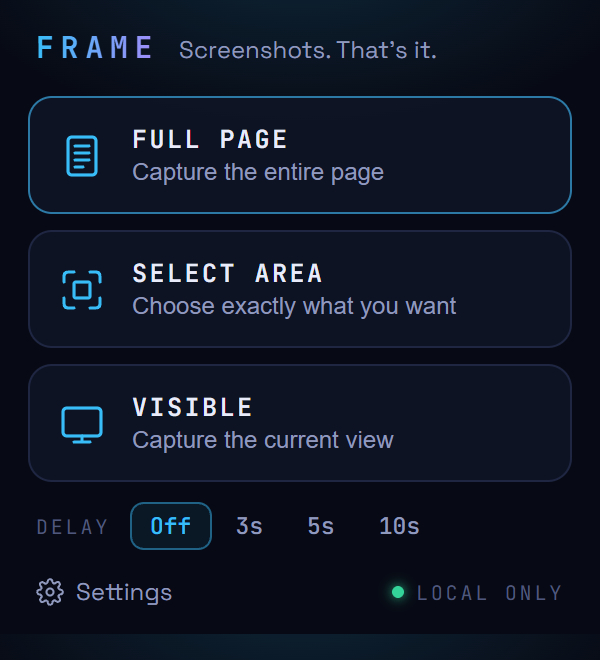

# FRAME

**Screenshots. That's it.**

FRAME is a small Chrome extension that takes screenshots: the full page, an area you select, or what's visible. Then you copy or save it. No account, no uploads, no tracking, no upsell. Everything happens on your computer.



Part of [Cyberdyne Network](https://cyberdynenetwork.com/).

## What it does

| | |
|---|---|
| **Full page** | Scrolls the page and stitches it into one image. Handles fixed and sticky headers (shown once, not on every screen), lazy-loaded images, smooth scrolling, HiDPI screens, and apps that scroll inside a panel instead of the page. Pages too tall for one image are split into parts. |
| **Select area** | Dims the page; drag a rectangle, adjust it, press Enter. Esc cancels. |
| **Visible** | Captures what you can see, immediately. |

**Delay**: the popup's `DELAY  Off · 3s · 5s · 10s` row waits before capturing, so you can open a menu, hover a tooltip or put the pointer somewhere useful first. A small countdown sits in the corner of the page (it's never in the screenshot) and on the toolbar icon; press Esc to cancel. For Select Area, the selection appears after the countdown. Your choice is remembered and also applies to the keyboard shortcuts. Off by default.

After a capture, a result tab opens where you can:

- **Copy** to the clipboard
- **Save** as PNG, JPEG or WebP
- **Crop**
- **Redact**: drag boxes over anything sensitive, as solid blocks or heavy pixelation
- **Annotate**: arrow, rectangle, freehand, text and highlight, with a few colours (red, yellow, blue, green, white, black, or pick your own), three stroke widths and three text sizes. Annotations become part of the image, just like crop and redact.
- **Undo** any edit

### Keyboard shortcuts

| Shortcut | Action |
|---|---|
| `Alt+Shift+F` | Open FRAME |
| `Alt+Shift+P` | Full page |
| `Alt+Shift+A` | Select area |
| `Alt+Shift+V` | Visible |

Change them at `chrome://extensions/shortcuts`. In the result tab: `C` crop, `R` redact, `A` annotate, `Z` zoom, `Ctrl+Z` undo, `Ctrl+C` copy, `Ctrl+S` save (`Ctrl+Shift+S` saves all parts).

### Settings

- **Default capture mode**: the one the popup highlights (Enter repeats it). Defaults to the last one you used.
- **Delay** is set in the popup itself (Off, 3, 5 or 10 seconds) and remembered.
- **Default format** and **JPEG/WebP quality**.
- **Save behavior**: straight to Downloads, or ask where to save. "Ask" remembers the last folder, so pointing it at a OneDrive, Google Drive, Dropbox or NAS folder once is all the "cloud integration" you need.
- **Filename template**: tokens `{domain}` `{title}` `{date}` `{time}` `{mode}`. Default `{domain}_{date}_{time}` → `github.com_2026-11-25_09-41-03.png`. Names are cleaned up so they're valid on Windows, macOS and Linux.
- **Include capture metadata** (off by default): writes the page URL, title and capture time as text inside the file (PNG text chunks, JPEG comment, WebP XMP). The pixels are never changed.

## Privacy

FRAME makes no network requests. Screenshots never leave your computer unless you send them somewhere. There's no analytics, no telemetry, no remote code, no remote fonts. See [PRIVACY.md](PRIVACY.md).

### Permissions

| Permission | Why |
|---|---|
| `activeTab` | Lets FRAME see the tab you clicked it on (or used a shortcut on), only that tab, only then. No "read all your data on all websites". |
| `scripting` | Runs the page-measuring script and the Select Area overlay in that tab. |
| `storage` | Stores your settings. |

Saving uses the browser's normal download / save dialog, and copying uses the standard clipboard API, so FRAME doesn't need the `downloads` or `clipboardWrite` permissions.

## Limits

- Chrome doesn't let extensions run on `chrome://` pages, the Chrome Web Store, or other extensions' pages. FRAME says so and offers a Visible capture where possible.
- Stay on the tab during a full-page capture or a countdown; switching tabs stops it cleanly.
- Very long pages are capped at 150,000 px (or 120 screens). Infinite-scroll feeds are captured as far as they had loaded.
- Select Area works within the visible part of the page. For a taller region, take a Full Page capture and crop it.

## Install

**From source** (until the Web Store listing is live):

1. Download or clone this repository.
2. Open `chrome://extensions` and turn on **Developer mode**.
3. Click **Load unpacked** and choose the `src` folder.

Works in Chrome 116+ and other Chromium browsers (Edge, Brave, Vivaldi, Arc).

## Development

The extension is plain HTML, CSS and JavaScript in `src/`: no framework, no build step, no runtime dependencies. You can read all of it.

```
src/
  manifest.json
  background.js        capture orchestration and stitching (service worker)
  lib/
    capture-page.js    injected for Full Page: measure, scroll, hide fixed UI, restore
    select-area.js     injected for Select Area: the overlay
    countdown-page.js  injected while a delayed capture counts down
    delay.js           the countdown timing (unit-tested without real waiting)
    store.js           hands captures to the result tab via IndexedDB
    settings.js  filename.js  metadata.js  diagnostics.js
  popup/  result/  options/
  fonts/  icons/
tests/                 Puppeteer end-to-end tests (capture, delay, annotate) with fixture pages + unit tests
tools/                 icon rendering, screenshots, packaging
```

Dev tooling needs Node.js 20+.

```bash
npm install
npm test            # unit + end-to-end tests in Chrome for Testing
npm run package     # dist/frame-<version>.zip for the Chrome Web Store
```

Set `FRAME_DPR=2` to run the end-to-end tests on a simulated HiDPI screen. If Puppeteer can't download Chrome for Testing, set `PUPPETEER_EXECUTABLE_PATH` to a Chromium that allows automation.

How full-page capture works, and why each permission is there, is in [docs/ARCHITECTURE.md](docs/ARCHITECTURE.md).

## Support

- [Report a bug](https://github.com/revpixel/frame/issues/new?template=bug_report.yml): FRAME's settings page has **Copy diagnostic info**, which includes versions and settings but never URLs or page content.
- [Request a feature](https://github.com/revpixel/frame/issues/new?template=feature_request.yml)

## License

[MIT](LICENSE). Fonts: Space Grotesk and JetBrains Mono, [SIL Open Font License](src/fonts/).
